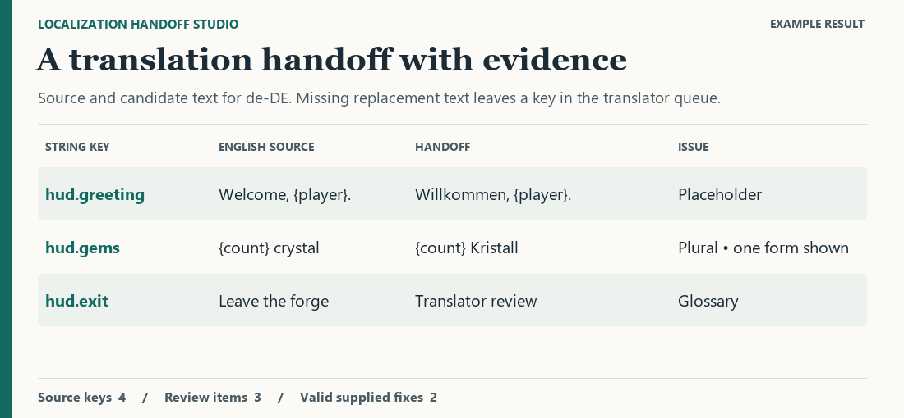
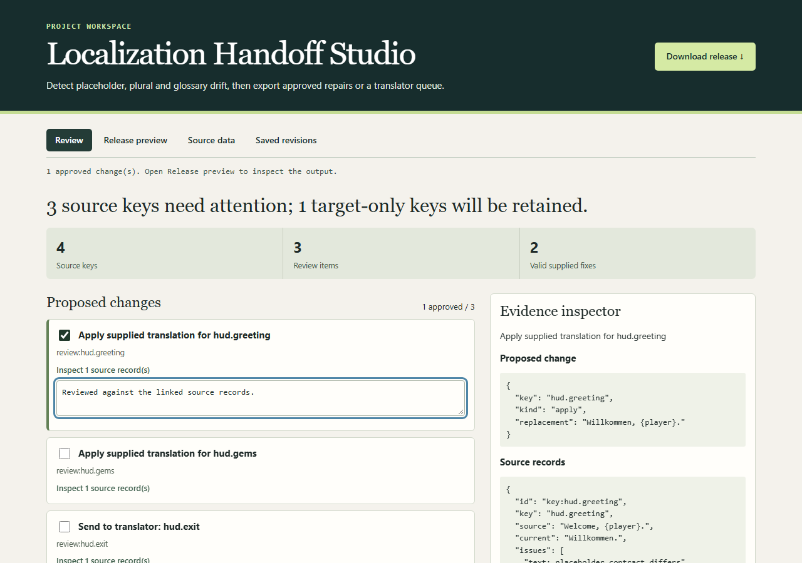

# Localization Handoff Studio

Detect placeholder, plural and glossary drift, then export approved repairs or a translator queue.

[](https://github.com/oguzhanozfe/localization-handoff-studio/actions/workflows/check.yml) · [Deploy to Render](https://render.com/deploy?repo=https://github.com/oguzhanozfe/localization-handoff-studio) · [Input guide](GUIDE.md)

A translated line can read well while dropping a player name or a plural form. Locate the exact key, inspect the mismatch and hand the translator a focused queue.



## Try it

With Python 3.11+ installed, clone this repository and run:

```sh
git clone https://github.com/oguzhanozfe/localization-handoff-studio.git
cd localization-handoff-studio
python app.py
```

Open <http://127.0.0.1:8000>. The synthetic example is loaded. Select a proposed change, inspect its source records, and open **Release preview** to see the resulting files. Choose **Download release** to save them.

## Walk through the example

Supply source and target JSON resource maps, a locale, required plural categories, optional glossary entries and optional human-written repairs. A resource is a plain string or a category-to-string plural object. Plural source maps must include `other`. The example German bundle has a dropped player name, an incomplete plural, a glossary mismatch and an obsolete target-only key.

**What the engine finds.** 3 source keys need attention; 1 target-only keys will be retained.

**Try this decision.** Approve **Apply supplied translation for hud.greeting**. The [example review](docs/example-review.json) lists the supporting record IDs and the checksum of each exported file. Its native outputs are [`de-DE.json`](docs/example-release/de-DE.json), [`repair-queue.json`](docs/example-release/repair-queue.json).

Reproduce that release at the command line:

```sh
python app.py analyze example.json
python app.py export example.json --approve "review:hud.greeting" --out reviewed.zip
```

## Model-assisted review

With a local model in Ollama or LM Studio, Azure OpenAI, Amazon Bedrock, or a compatible API connected, select **Request suggestions**. The model examines up to eight candidate actions. Each displayed suggestion links to one of that action's source records. Approving a change and recording a review note remain explicit reviewer actions.

The app runs locally with Python's standard library. The Docker image includes the Bedrock SDK and the production web server. The same UI can save immutable revisions, reopen a workspace and compare decisions. See [model settings, Docker deployment and the HTTP API](docs/deployment.md).



## Development

The domain algorithm and exporter live in [pipeline.py](pipeline.py). The [method guide](GUIDE.md) describes its input assumptions and limitations. Install test dependencies and run the suite:

```sh
python -m pip install -r requirements.txt
python -m unittest discover -v
```

[MIT license](LICENSE)
